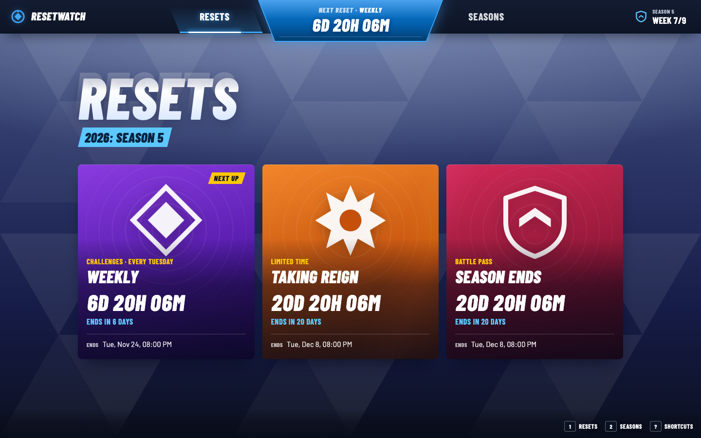
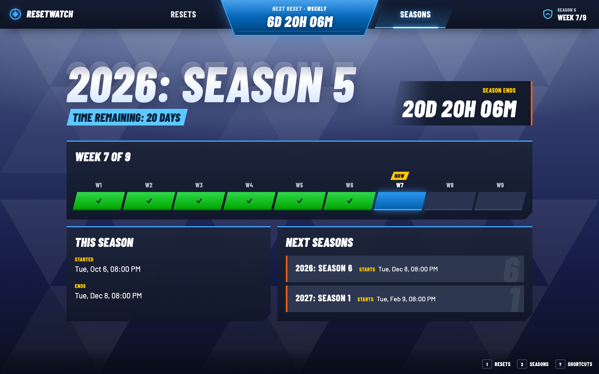
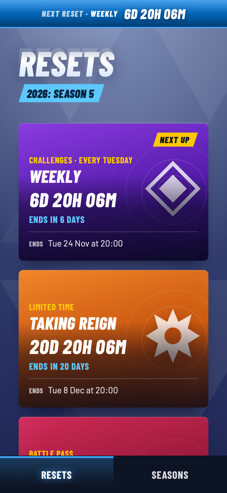

# Resetwatch

Live countdown to the Overwatch **weekly reset**, the current **event end** and the **season end**, shown in your own time zone. Styled after the current in-game menu.

**Live site: [resetwatch.tostu.net](https://resetwatch.tostu.net)**



## Features

- Countdown cards for the weekly reset (Tuesday, 2 PM ET / 11 AM PT), live and upcoming events, and the season end.
- Season page with week-by-week progress (`WEEK 7 OF 9`) and the start dates of the next seasons.
- Times rendered in the viewer's local zone. The reset itself is computed in `America/New_York`, DST safe.
- Live countdown in the tab title while the tab is in the background.
- Keyboard shortcuts (`1` Resets, `2` Seasons, `?` Shortcuts).
- Responsive: top bar on desktop, bottom tab bar on mobile.
- SEO basics: static title and description, JSON-LD (WebSite, FAQPage), `sitemap.xml`, `robots.txt`, `llms.txt`.

| Seasons | Mobile |
| --- | --- |
|  |  |

## How it works

Two parts, both on Cloudflare:

```
Steam news feed ──> resetwatch-ingest (Worker, cron */5) ──> D1 ──┐
                       Workers AI extracts dates                   │ rebuild hook
                                                                   ▼
                          resetwatch (SvelteKit, static) <── build bakes D1 rows
                                                             into events.json
```

- **`resetwatch/`** (this folder): SvelteKit 5 + Tailwind 4, built with `adapter-static` and served as Workers static assets. No Worker runs per request.
- **`../resetwatch-ingest/`**: a cron Worker. Polls the Overwatch Steam news feed with ETag, extracts season and event dates with Workers AI, stores them in D1, then triggers a rebuild of the site when something changed.
- **`scripts/fetch-events.ts`** runs before `vite build`, queries D1 and writes `src/lib/data/events.json`. It never fails the build: without credentials or on error it keeps the existing file.
- **`src/lib/resets.ts`** holds the config and all time math. Seasons, events and patches all go live at the weekly reset, so every date from D1 is snapped to the nearest reset. Hardcoded values in `CONFIG` are fallbacks only.

## Getting started

Requires [Bun](https://bun.sh).

```sh
bun install
bun run dev        # http://localhost:5173
```

Without D1 credentials the site runs on the hardcoded fallbacks in `CONFIG`.

### Scripts

| Command | What it does |
| --- | --- |
| `bun run dev` | Vite dev server |
| `bun run build` | Bake events from D1, check Worker types, build to `build/` |
| `bun run preview` | Serve the production build on port 4173 |
| `bun run fetch-events` | Only refresh `src/lib/data/events.json` |
| `bun run check` | Svelte and TypeScript checks |
| `bun run lint` / `format` | Prettier and ESLint |
| `bun run test:unit` | Vitest |
| `bun run test:e2e` | Playwright |

### Configuration

Copy `.env.example` to `.env`. All three are optional:

| Variable | Purpose |
| --- | --- |
| `CF_API_TOKEN` | Cloudflare API token with Account > D1 > Read |
| `CF_ACCOUNT_ID` | Cloudflare account id |
| `D1_DATABASE_ID` | D1 database id of `resetwatch` |

Set the same three as build variables in Cloudflare Workers Builds. The ingest Worker's `REBUILD_HOOK_URL` secret must point to this project's deploy hook.

To change reset times or add fallback seasons, edit `CONFIG` in [`src/lib/resets.ts`](src/lib/resets.ts).

## Project layout

```
src/
  lib/
    resets.ts          config, time math, season and event logic
    resets.spec.ts     unit tests
    seo.ts             titles, FAQ list, JSON-LD
    components/        TopBar, ResetCard, KeyHints, ...
    data/events.json   baked from D1
  routes/              /, /seasons, /faq, /privacy
scripts/fetch-events.ts
docs/screenshots/
design.md              visual spec, derived from the in-game UI
```

## Deploy

```sh
bun run build
bunx wrangler deploy
```

The ingest Worker is deployed separately from `../resetwatch-ingest` with `wrangler deploy`.

## Disclaimer

Fan project. Not affiliated with or endorsed by Blizzard Entertainment. Overwatch is a trademark of Blizzard Entertainment, Inc.
